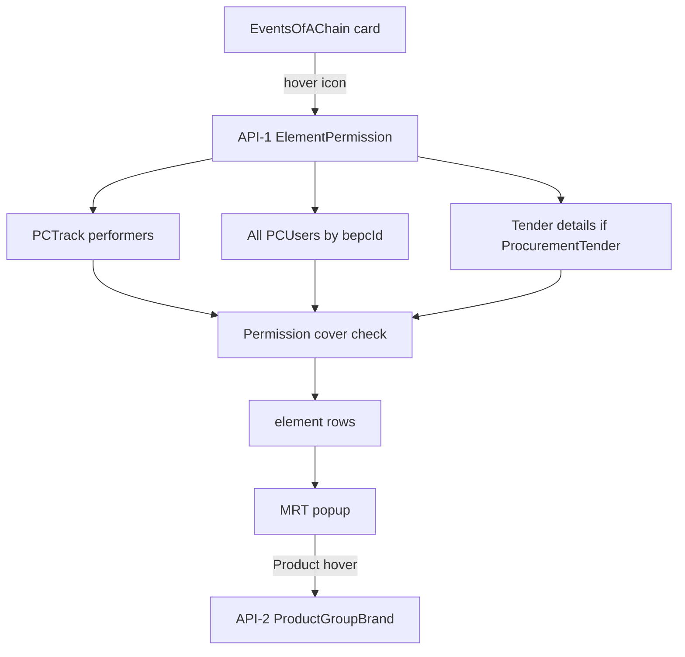

# Element Permission Popup — exact prompts, answers, plan

**Date:** 2026-10-12  
**Related:** `docs/ai-work/history/TASK-20261012-element-permission-popup.md`

---

# PART A — Exact user prompts & answers

নিচে যতটা সম্ভব **user-এর exact text** রাখা হয়েছে (copy from chat)।

---

## Prompt 1 — মূল requirement (exact)

```
emon ekta api lagbe jekhane ami 

send korbo- eventNo, firstEventNo, sequence, biznessEventProcessConfigurationId, locationId, companyId

aar receive korbo emon kichu
 
[
	{
	elementName: "Android", elementIdentity: "Product Group", status: "Done", authorizedTo: [{securityUserId: , userName:, locationName:, biznessEventPCUserId:}, {securityUserId: , userName:, locationName:, biznessEventPCUserId:}], doneBy: [{securityUserId: , userName:, locationName:, biznessEventPCUserId:}, {securityUserId: , userName:, locationName:, biznessEventPCUserId:}]
	}
	{
	elementName: "Yamaha", elementIdentity: "Brand", status: "Pending", authorizedTo: [{securityUserId: , userName:, locationName:, biznessEventPCUserId:}, {securityUserId: , userName:, locationName:, biznessEventPCUserId:}], doneBy: []
	}
]
 


Tumi koyekta table database theke khub valo kore analysis koro and eder moddhe relation gula observe koro:

BiznessEventProcessConfiguration, BiznessEvent_PCTrack,BiznessEvent_PCLocation, BiznessEvent_PCUser, BiznessEvent_PCUserProduct, BiznessEvent_PC_UserProductGroup, BiznessEvent_PC_UserBrand, ProcurementTenderDetail, ProcurementTender, Product, ProductGroup, Brand, SecurityUser, Location, BiznessEvent

Accha, prothomoto- Ami api te eventNo, firstEventNo, sequence, biznessEventProcessConfigurationId, locationId pathaitesi. Eigula diye BiznessEvent_PCTrack e filter korbo. Oikhan theke onekgula row pete paari, distinct "PerformedBy" and "locationId" paabo. Ei "PerformedBy" hoilo userId or securityUserId. ei locationId diye and biznessEventProcessConfigurationId diye filter korbo BiznessEvent_PCLocation table theke amra BiznessEventPCLocationId ber korbo. Then BiznessEventPCLocationId aar userId(PerformedBy) diye filter korbo BiznessEvent_PCUser table e, sheikhan theke single/mutiple rows theke:


point1. distinct BiznessEventPCUserId pabo. 

Ekhon, BiznessEvent_PCUserProduct, BiznessEvent_PC_UserProductGroup, BiznessEvent_PC_UserBrand, ei 3ta table e BiznessEventPCUserId wise rows thaake. Ei 3ta table mean kore- ekta userId er actually locationWise(locationId) kon kon productGroup, product or Brand er upor permission ache. Product hoitese shob cheye last level. Maane ekta ProductGroup er onekgula brand and product thakte paare. Abar ekta Brand er onekgula productGroup and product thakte paare. Kono ekta biznessEventPCUserId er against e BiznessEvent_PC_UserProductGroup e ekta/muttiple row thakte paare ProductGroupId wise, and  BiznessEvent_PC_UserBrand ae kono row and BiznessEvent_PCUserProduct e kono row nao thakte pare(abar thakteo paare different case)- means Oi biznessEventPCUserId er jonno oi productGroupId er shokol product or brand permitted. Taar maane kono ekta table jodi empty thake for a certain BiznessEventPCUserId, taar maane ProductGroup/Brand/Product (depends on kon table empty- BiznessEvent_PC_UserProductGroup,BiznessEvent_PC_UserBrand,BiznessEvent_PCUserProduct) tahole ashole all ProductGroup/Brand/Product permitted.

Taar maane suppose BiznessEvent_PC_UserProductGroup e ekta certain BiznessEventPCUserId er jonno ache productGroupId=352 (Computer). Aar baaki tables- BiznessEvent_PC_UserBrand, BiznessEvent_PCUserProduct empty. It means- shokol productId(means products from product db table of that companyId(companyId diye filtered all product db table's rows- api er receiving param companyId)) and shokol brandId (companyId diye filtered all brand db table's rows- api er receiving param companyId)) oi BiznessEventPCUserId er jonno allowed. Same vabe BiznessEvent_PC_UserProductGroup eo ekta productGroup declared and BiznessEvent_PC_UserBrand eo ekta brand declared and BiznessEvent_PCUserProduct e kono product declared nei- that means- oi productGroupId and BrandId diye product db table e joto product paoa jaabe shob allowed. So, bujhtei parteso- shudhu BiznessEvent_PC_UserBrand e row ache, BiznessEvent_PC_UserProductGroup and BiznessEvent_PCUserProduct empty- means all product of that BrandId. 


Accha, tahole ekhon, ekta BiznessEventPCUserId er jonno permitted product er ekta list paabo eivabe. Evabe jotogula BiznessEventPCUserId paabo from performedBy and locationId and BiznessProcessConfigurationId columns of BiznessEvent_PCTrack table(maane eigula diye BiznessEvent_PCLocation theke BiznessEventPCUserId pai jevabe- multiple BiznessEventPCUserId paitei paari)-shob gula BiznessEventPCUserId er permitted products pabo(shob product level e convert kore- no matter productGroup defined thakuk or Brand in BiznessEvent_PC_UserProductGroup or BiznessEvent_PC_UserBrand table). 

point2. ~sheikhan theke single/mutiple rows theke distinct single biznessEventProcessConfigurationId paabo, ba api e receive kore biznessEventProcessConfigurationId, oitao nite paari. Oi BiznessEventProcessConfigurationId niye BiznessEventProcessConfiguration db table theke filter korle row theke biznessEventId and extenderBiznessEventId pabo(string field 'number#number#number....' evabe lekha thake, # diye separate kore extract korle biznessEventId gula paoa jaabe). Ei BiznessEventId gular konotar BiznessEvent.Name jodi 'ProcurementTender' hoy then-
oi eventNo ta ashole ProcurementTender.TenderNo
ekhon ei tenderNo ki ki product or productGroup diye created sheita amra paabo procurementTenderDetail theke with procurementTenderId of that ProcurementTender.TenderNo

Taahole ekta TenderNo/ eventNo e ki ki productGroup or Product ache shegula amra ekta list e peye gelam.


ekhon point1 theke pawa list aar point2 theke pawa list er moddhe compare korte hobe. Dhori ekta Tender "X" productGroup aar "1" Product diye created(ProcurementTenderDetail e duita row, ekta row te jodi duita column productGroupId and ProductId te value thake maane not null hoy, then amra oi row ta productId er upore dhorbo, productGroupId dhorar dorkar nei). ekhon dekhte hobe point 1 er BiznessEventPCUserId er allowed ProductGroups or Products er moddhe "X" productGroup and "1" product shob cover hoye jaay kina. 

jodi "X" cover hoy, then X er jonno elementName,elementIdentity,status,doneBy kon kon biznessEventPCUserId-then oita theke securityUser.Name(userName) and location table theke location.Name(locationName) ber kore api te sent hobe-

	{
	elementName: "X", elementIdentity: "Product Group", status: "Done", authorizedTo: [{securityUserId: , userName:, locationName:, biznessEventPCUserId}, {securityUserId: , userName:, locationName:, biznessEventPCUserId}], doneBy: [{securityUserId: , userName:, locationName:, biznessEventPCUserId:}, {securityUserId: , userName:, locationName:, biznessEventPCUserId}]
	}
jodi cover na hoto, then status hoito pending, aar done by e kono object e thaktona logically.

authorizedTo ta kivabe ber korbo question hote paare. authorizedTo ber hobe shei shob BiznessEventPCUserId gula theke- api er recieveing parameter e biznessEventProcessConfigurationId ache. oi id diye filter kore BiznessEvent_PCUser table theke amra onekgula BiznessEventPCUserId paabo. Tarpor dekhte hobe TenderNo ta ki ki productGroup, brand, product niye created. Ei BiznessEventPCUserId er jaeder kache ei productGroup/ product er permission ache- procurementTender detail er ekta example er jonno dhorsilam productGroup 'X' ache aar product"1" ache. Ekhon filtered BiznessEventPCUserId er theke jegular permission table er maddhome(BiznessEvent_PC_UserProductGroup,BiznessEvent_PC_UserBrand,BiznessEvent_PCUserProduct eigular moddhe BiznessEventPCUserId wise permissions thake we know that) productGroup "X" allow kora ache- tarai authorizedTo for productGroup- X / elementName 'X'. BiznessEventPCUserId theke eventually associated locationId and securityUserId theke locationName and userName paoa jabe. 

Same vaabe for product "1"

Accha, ekhon tumi frontend er EventsOfAChain page and er shathe related frontend modules/files/elements valo vabe observe koro. eikhane Card er upor ekta permission type er kono icon thakbe jeitay hover korle ekta popup or modal dekhabe- oi popup er moddhe api theke paoa data material-react-grid er maddhome dekhabe. Screen shot diye concept ta bujhano hoise- aro cool, premium vabe dekhaite chaile dekhaite paaro. And oije 8person lekha oikhane hover korle UserName aar locationName dekhabe. 

frontend e onHover of that icon e popup open hoye api call hoye loading shesh hoye(skeleton) then data show korbe.


Then another Api I need, where if send a productId, the api will send that product's-
 
{productGroupName: , productGroupId, brandId: ,brandName: }

ekhon oi popup er Product er upor hover korle (Identity te jodi product thaake), oi product er productGroupname, BrandName dekhaya dibe e api call er maddhome. 


Purata valo vaabe bujho, chinta koro, kono gap or confusion thakle ask kore plan banao ki korba. Plan execution e tomar je language e banaor banao(maybe english), amar jonno banglay banaba, and khub shundor vaabe simple vaabe likhba jaate ki korba ami easily pore bujhte paari. Jotota shomvob simple er moddhe concise rakhba. Tumi jano backend kothay, oitar appsettings.json e connectionString ache, oikhan theke db read korte parba.
```

---

## Prompt 2 — Round-1 answers (exact)

*(AI-এর প্রশ্নের পর user-এর exact reply)*

```
**Brand element কোথা থেকে?
Sample-এ elementIdentity: "Brand" আছে, কিন্তু tender detail-এ Brand column নেই।

শুধু Product Group + Product দেখাবো? 
নাকি Product থেকে Product.BrandId derive করে Brand row আলাদা দেখাবো?
ANS: শুধু Product Group + Product

**locationId কোনটা পাঠাবো?
Card-এর eventLocationId, না login user-এর locationId?
ANS:login user-এর locationId pathaba to API

**sequence = PCTrack-এর কোন field?
OriginalSequence না NextSequence?
ANS:OriginalSequence

**Event যদি ProcurementTender না হয়?
Empty array ফেরত? নাকি অন্য voucher-ও সাপোর্ট?
ANS: Empty array ফেরত, and frontend e popup e bolbe "No details available for this"

**Product Group “cover” মানে কী?

User-এর PG permission-এ ওই group আছে (বা PG table খালি = all), না
ওই group-এর সব product permitted?
ANS: oi group PG permission-এ  আছে

**“8 person” badge = authorizedTo.length? (ধরে নিচ্ছি হ্যাঁ)
ANS: Hae thik

**Screenshot attach হয়নি—popup-এ columns কি এগুলোই?
elementName | elementIdentity | status | authorizedTo | doneBy
ANS: Hae. Ami SS diyechi ekhon. SS dekhe representation concept nao, but ui/ux concept amader br24 er vibe/theme follow korbe, and cool/premium hobe


aar kono confusion?
```

*(এই message-এ screenshot attach ছিল — table: Elements, Identity, Authorized To, Status, Done By; Done=green, Pending=red)*

---

## Prompt 3 — Round-2 answers (exact)

```
1. Done By কলামে কী দেখাবো?
API-তে doneBy array (অনেক user হতে পারে)।
SS-এ একটা নাম: Chinmoy।

কী চাও?

A) একজন হলে নাম, একাধিক হলে 3 persons → hover-এ list
B) সবসময় প্রথম নাম (+ আর থাকলে +2)
C) অন্য কিছু
(Authorized To = N persons + hover — এটা already clear।)

ANS: একজন হলে নাম, একাধিক হলে 3 persons → hover-এ list

2. Product element-এর “cover” rule?
Product Group-এর জন্য বলেছো: শুধু PG permission-এ group আছে কিনা।

Product-এর জন্য confirm করো:

User-এর permission	Product “1” cover হবে যদি…
শুধু PG আছে (Brand/Product খালি)
Product-এর GroupId ওই PG list-এ আছে
শুধু Brand আছে (PG/Product খালি)
Product-এর BrandId ওই Brand list-এ আছে
Product table-এ row আছে
ওই ProductId list-এ আছে
একাধিক টেবিলে row
উপরের যেগুলো non-empty, সবগুলো match (AND)
তিনটেই খালি
company-র সব product → cover
এটাই কি ঠিক?

ANS: Hae thik

3. doneBy / Status — location scope
API-তে locationId = login user-এর location।
তাহলে PCTrack থেকে performers শুধু ঐ location-এর track থেকে আসবে।

মানে: অন্য location-এ কেউ করে থাকলেও, আমি অন্য location থেকে দেখলে doneBy খালি / Pending দেখাবে—ঠিক আছে?

ANS: DoneBy er location amra pabo pctrack er locationId othoba bola jaay BiznessEvent_PCUser->BiznessEventPCLocationId.LocationId theke. Oitai show hobe Done By er ekta userName er location.
Frontend e tabular shape e dekhano jete paare:
UserName | Location

or icons diye card style eo dekhano jete paare, make it cool and premium.

অতিরিক্ত (ছোট, ধরে নিতে পারি)
Entry New card (eventNo খালি) → icon hide বা click করলে “No details…” — কোনটা? icon hide thakuk
SS-এ Brand row ছিল; real data-তে শুধু Product Group + Product — OK। hae ok
Row color: Done = soft green, Pending = soft red/pink; BR24 theme-এ premium করে — OK। hae ok. Done aar pending er color theme er accent manbena, greeninsh/ reddish constant thakbe.


Aar kono confusion or corner case? 
```

---

## Prompt 4 — PCTrack location filter = B + corner cases OK (exact)

```
 login location দিয়ে PCTrack filter korbona, api te pathano locationId diye PCTrack filtered hobena. Ans B.

Corner Cases:
all ok

aar kono confusion?
```

*(Context — AI Option B ছিল: PCTrack filter-এ location বাদ; সব location-এর performers; প্রত্যেকের নিজের location দেখাও)*

---

## Prompt 5 — locationId API param = A (exact)

```
Ans: A

aar kono confusion?
```

*(Context — AI Option A ছিল: locationId param থেকে বাদ → API-1 params = eventNo, firstEventNo, sequence, bepcId, companyId)*

---

## Prompt 6 — Plan.md + Backend go (exact)

```
Plan er .md banao aage. Aar hae, backend modify korbe ei kaaj er jonno- explicit go (DB te kono modification korbana)
```

---

## Prompt 7 — Implement plan (exact)

```
Implement the plan as specified, it is attached for your reference. Do NOT edit the plan file itself.

To-do's from the plan have already been created. Do not create them again. Mark them as in_progress as you work, starting with the first one. Don't stop until you have completed all the to-dos.
```

---

## Prompt 8 — Save notes to project (exact)

```
Tomake ami ja ja prompt disi and tumi ja ja questions korso and kichu topic er j confirmation niso, oigula .md file e rakho, ei project er moddhe- maybe cursor folder er kono jaygay. ElementPermissionPopup er j plan ta banaiso, oitao rakho oikhane
```

---

## Prompt 9 — Exact prompts & answers only (exact)

```
amar exact prompt gula and answer gula rakho
```

---

# PART B — AI questions (context only — so answers উপরের make sense)

### Round 1 questions (AI)
1. Brand element কোথা থেকে — শুধু PG+Product নাকি Brand derive?
2. locationId — eventLocationId নাকি login locationId?
3. sequence — OriginalSequence নাকি NextSequence?
4. Non-ProcurementTender — empty নাকি অন্য voucher?
5. Product Group cover — PG permission নাকি সব product?
6. 8 persons = authorizedTo.length?
7. Popup columns confirm + SS?

### Round 2 questions (AI)
1. Done By display A/B/C?
2. Product cover AND rules confirm?
3. Login location দিয়ে PCTrack filter → অন্য location Pending — OK?
4. Entry New icon hide?
5. Brand SS vs real OK?
6. Row color constant green/red OK?

### Round 3 (AI)
- doneBy location scope Option A vs B  
- Corner case defaults 1–8

### Round 4 (AI)
- locationId API param রাখব নাকি বাদ (A vs B)?

---

# PART C — Final plan (as agreed / CreatePlan)

## Scope

- **Backend:** ২টা নতুন read API (explicit go) — শুধু C#; **DB schema / SP / migration নেই**
- **Frontend:** `EventsOfAChain` card icon + hover popup
- **বাইরে:** DB change, Brand element, Entry New-এ icon

## Locked decisions

| বিষয় | সিদ্ধান্ত |
|---|---|
| Elements | শুধু Product Group + Product |
| API-1 params | `eventNo, firstEventNo, sequence, biznessEventProcessConfigurationId, companyId` (locationId নেই) |
| Tender gate (BE) | `BiznessEventProcessConfiguration.ControllerPath == "component#TenderRequisition"` (আগে ছিল `BiznessEvent.Name == ProcurementTender`) |
| Icon show (FE) | `eventNo` + `controllerPathType === "component"` + `controllerPath === "TenderRequisition"` (SA_NextEvent slice `#` split করে রাখে) |
| PCTrack sequence | `OriginalSequence` |
| PCTrack location filter | **না** — সব location-এর performers |
| Non-Tender / wrong path | `[]` + FE: "No details available for this" (iconও hide যদি path না মিলে) |
| PG cover | PG permission-এ group আছে / PG table খালি = all |
| Product cover | non-empty dimensions AND; তিনটে খালি = company সব product |
| Authorized To UI | `N persons` → hover UserName \| Location |
| Done By UI | ১জন = নাম; একাধিক = `N persons` → hover |
| Entry New | icon **hide** |
| Row color | Done soft green / Pending soft red (constant) |

## Data flow



## Backend (no DB change)

**Controller:** `BiznessEvent_PCTrackController`  
**Repo:** `BiznessEvent_PCTrackRepository`

### API-1 — `GET .../getElementPermissionStatusByEvent`

**Query:** `eventNo, firstEventNo, sequence, biznessEventProcessConfigurationId, companyId`

**Steps:**
1. BEPC → BiznessEventId + ExtendedBiznessEventId (`#` split) → Name = ProcurementTender না হলে `[]`
2. eventNo = TenderNo → Detail elements (ProductId → Product; else ProductGroup)
3. done candidates: PCTrack (EventNo + FirstEventNo + OriginalSequence + bepcId) → PCLocation → PCUser
4. authorized candidates: bepcId-এর সব PCUser
5. permission cover rules
6. per element → authorizedTo / doneBy → status Done|Pending

**DTO:** elementName, elementIdentity, elementId, status, authorizedTo[], doneBy[]

### API-2 — `GET .../getProductGroupAndBrandByProductId`

**Query:** productId  
**Return:** `{ productGroupId, productGroupName, brandId, brandName }`

## Frontend

- `EventsOfAChain.tsx` + `ElementPermissionPopover.tsx`
- Hover → skeleton → MRT
- Columns: Elements, Identity, Authorized To, Status, Done By
- Entry New: icon hide
- Empty: "No details available for this"

## Verification

- Tender card green/red rows
- Non-Tender empty message
- Entry New no icon
- Product hover group/brand
- Multi-location doneBy locations
